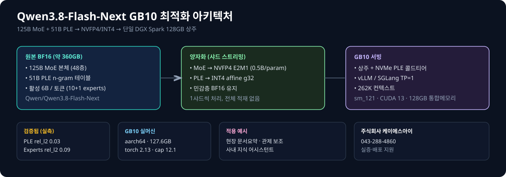
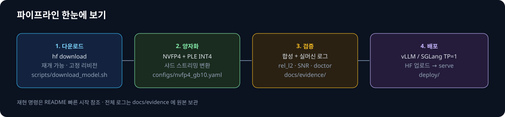
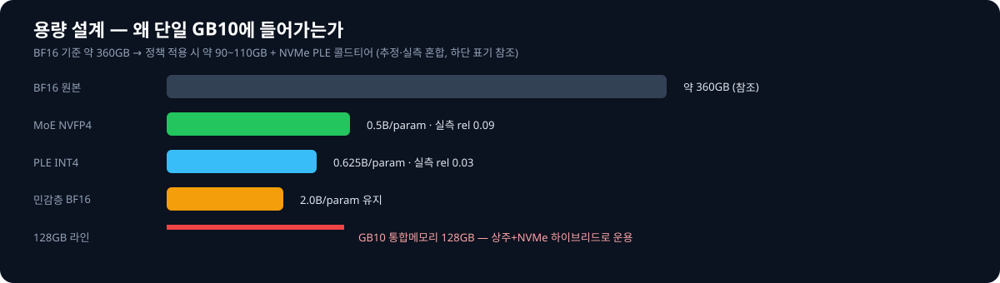
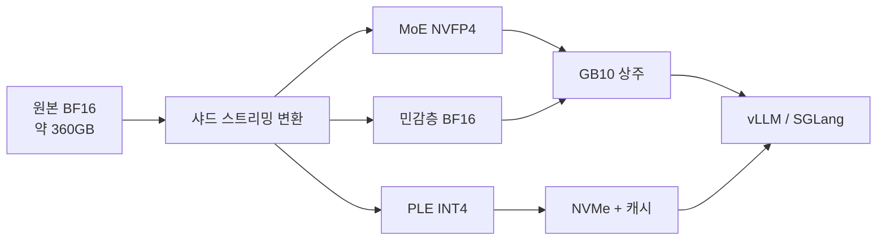

# Qwen3.8-Flash-Next-GB10-NVFP4

> **GB10(DGX Spark) 단일머신에 125B MoE를 통째로 올리는 양자화·서빙 실증 프로젝트**
> 원본 BF16 약 360GB → **NVFP4 + PLE-INT4 + BF16 혼합**으로 128GB 통합메모리에 상주. 전부 실머신 실측 기반.

[](scripts/setup_env.sh)
[](tools/gb10_doctor.py)
[](configs/nvfp4_gb10.yaml)
[](docs/evidence/gb10_doctor.json)
[](LICENSE)

- 베이스 모델: [Qwen/Qwen3.8-Flash-Next](https://huggingface.co/Qwen/Qwen3.8-Flash-Next)
- 양자화 모델: [khakisketch/Qwen3.8-Flash-Next-GB10-NVFP4](https://huggingface.co/khakisketch/Qwen3.8-Flash-Next-GB10-NVFP4)
- 제작: **주식회사 케이에스아이 · 043-288-4860**

---

## 한눈에 보기





| 구분 | 방식 | 실측 결과 | 원본 로그 |
|---|---|---|---|
| MoE experts | NVFP4 E2M1, block 16 | rel_l2 약 0.09 | `docs/evidence/experts_nvfp4_selftest.txt` |
| PLE 51B 테이블 | affine UINT4 g32 | rel_l2 약 0.03, SNR 30dB | `docs/evidence/ple_int4_selftest.txt` |
| 샤드 스트리밍 | 1샤드씩 변환 | PLE 0.030 / experts 0.094 | `docs/evidence/streaming_convert_synthetic.txt` |
| GB10 실머신 | aarch64, 127.6GB | `gb10_detected: true` | `docs/evidence/gb10_doctor.json` |

## 왜 이 프로젝트인가

125B MoE + 51B PLE는 BF16 그대로면 GB10 128GB에 들어가지 않습니다.
이 프로젝트는 **무거운 두 부분만 정밀하게 줄이고(0.5~0.625B/param), 민감층은 BF16으로 둬서**
단일 DGX Spark에서 돌리는 것을 목표로 합니다. PLE는 NVMe 콜드티어 + LRU 캐시로 운용합니다.

## 5분 빠른 시작

```bash
# 0) 환경 점검 (GB10 실머신 기준)
bash scripts/setup_env.sh
.venv/bin/python tools/gb10_doctor.py --skip-docker

# 1) 다운로드 없이 검증부터 (합성 테스트)
.venv/bin/python -m quantization.ple_int4 --self-test
.venv/bin/python -m quantization.experts_nvfp4 --self-test
.venv/bin/python -m quantization.streaming_convert --synthetic-test

# 2) 원본 다운로드 (재개 가능, 고정 리비전)
MODEL_ID=Qwen/Qwen3.8-Flash-Next bash scripts/download_model.sh

# 3) 서빙 (양자화 레포 기준)
bash deploy/serve_vllm.sh
# 또는
bash deploy/serve_sglang.sh
```

자세한 순서는 [`docs/deployment.md`](docs/deployment.md), 설계는 [`docs/architecture.md`](docs/architecture.md)를 보세요.

## 연구일지처럼 읽기

정리본: [`docs/research-log.md`](docs/research-log.md) — Day 1~5 (인벤토리 → 코덱 선정 → 스트리밍 변환 → PLE 런타임 → GB10 실측)



## 실제 모델 구성

- **본체**: 125B MoE, 48층 (GDN + QSA 하이브리드), 토큰당 활성 약 6B (routed 10 + shared 1)
- **PLE**: 51B n-gram 임베딩 테이블 → INT4 affine g32로 패킹, `ple_int4_manifest.json`이 위치 지도 역할
- **MTP**: 1층, **비전**: 27층, **컨텍스트**: 네이티브 262,144 토큰
- **정책 파일**: [`configs/nvfp4_gb10.yaml`](configs/nvfp4_gb10.yaml)

## 디렉터리 안내

```
├── quantization/   # NVFP4 / PLE-INT4 코덱 + 샤드 스트리밍 변환기 (실측 포함)
├── runtime/        # PLE NVMe 스토어 + Qwen4Exp 패치 + 3단 검증
├── tools/          # gb10_doctor, smoke test, 인벤토리, 벤치
├── kernels/        # sm_121 FP4/INT4 GEMM 게이트 실험
├── scripts/        # 다운로드 → 양자화 → 업로드 파이프라인
├── configs/        # 양자화 정책 + 서빙 프리셋
├── deploy/         # vLLM/SGLang/Compose 실서빙 파일
├── containers/     # NGC 컨테이너 운영 원칙
├── benchmarks/     # 합성 실측 결과표
├── evals/          # BF16 참조 하네스 + 프롬프트
├── docs/           # 연구일지·아키텍처·배포·증빙·이미지
└── licenses/       # 라이선스 안내
```

## 배포 실증

- GB10 판정 실측: `arch_ok true`, `gb10_detected true`, RAM 127.6GB, torch 2.13.0+cu130, cap 12.1 ([`docs/evidence/gb10_doctor.json`](docs/evidence/gb10_doctor.json))
- 서빙 파일: [`deploy/docker-compose.gb10.yaml`](deploy/docker-compose.gb10.yaml), [`deploy/serve_vllm.sh`](deploy/serve_vllm.sh), [`deploy/serve_sglang.sh`](deploy/serve_sglang.sh)
- 컨테이너 원칙: 호스트에 vLLM+SGLang+torch 혼합 설치 금지 → 고정 NGC 컨테이너 사용 ([`containers/README.md`](containers/README.md))
- 남은 실증: 풀 360GB 변환 후 TTFT/TPOT 계측, BF16 참조 대비 사람 평가 (`scripts/accuracy_baseline.py`)

## 적용 예시 (현장명 무관)

- 건설·토공 현장 문서 요약 어시스턴트
- CCTV 관제 일지 구조화 요약 보조
- 사내 지식·규정 검색 어시스턴트

> 예시이며, 각 현장의 보안·개인정보·전산 규정을 따릅니다. 도입·실증 지원은 하단 연락처로 문의하세요.

## 라이선스

- 모델/가중치: Qwen Community License 1.0 ([`LICENSE`](LICENSE), [`licenses/README.md`](licenses/README.md))
- "AI Work Assistant" 상용 이용은 별도 Qwen 라이선스 필요 (model-business@notice.qwencloud.com)

---

### 만든 곳

**주식회사 케이에스아이 (KSI Corporation)** — 현장형 AI 실증·배포
전화: **043-288-4860** · GitHub: [khakisketch](https://github.com/khakisketch) · 모델: [HF 레포](https://huggingface.co/khakisketch/Qwen3.8-Flash-Next-GB10-NVFP4)

> 이슈·도입 문의 환영합니다. GB10 실머신 기준 재현 로그(`docs/evidence/`)와 함께 제보해주시면 가장 빠릅니다.
