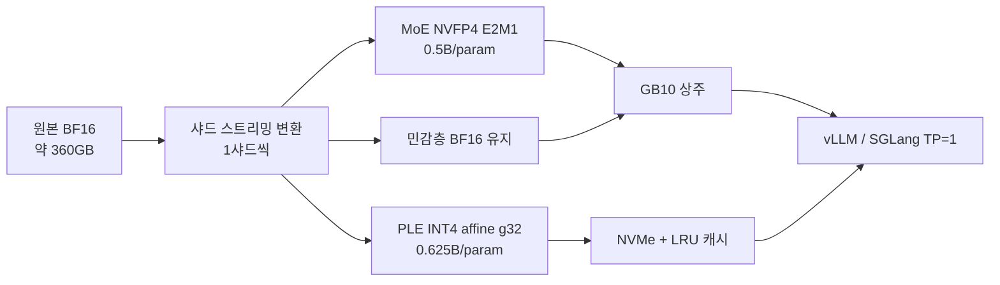

# 아키텍처

## 원본 모델 (인용)

- 출처: [Qwen/Qwen3.8-Flash-Next](https://huggingface.co/Qwen/Qwen3.8-Flash-Next)
- 125B MoE 본체(48층, GDN+QSA 하이브리드) + 51B PLE n-gram + MTP 1층 + 비전 27층
- 토큰당 활성 약 6B (routed 10 + shared 1), 네이티브 262K 컨텍스트
- BF16 약 360GB — GB10 128GB에 그대로 못 들어감

## 우리 설계 (실측 기반)

- 양자화 정책: `configs/nvfp4.yaml`
- 변환기: `quantization/streaming_convert.py` (합성 실측 rel 0.03/0.09)
- PLE 런타임: `runtime/ple_store.py` + `runtime/patch_qwen4_exp.py`
- 하드웨어 게이트: `tools/gb10_doctor.py`, `kernels/fp4_microproof.py`

## 서빙

- vLLM: `deploy/serve_vllm.sh`, `configs/serve_vllm.yaml`
- SGLang: `deploy/serve_sglang.sh`, `configs/serve_sglang.yaml`
- Compose: `deploy/docker-compose.gb10.yaml`
