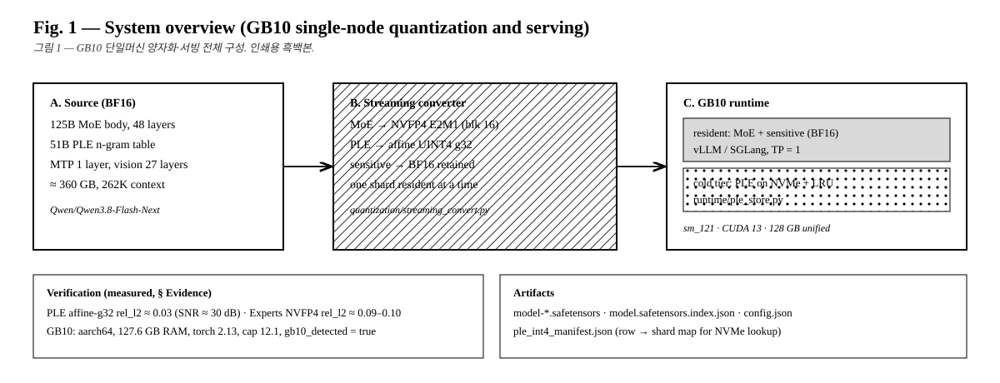
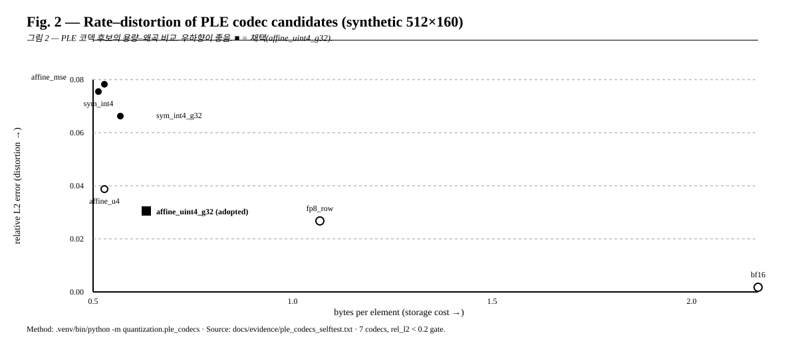
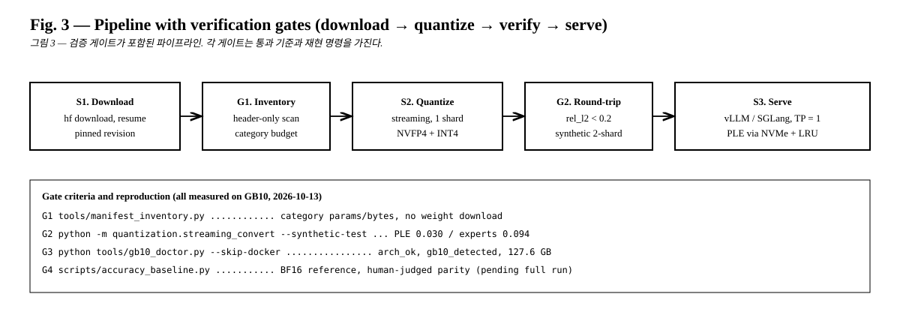
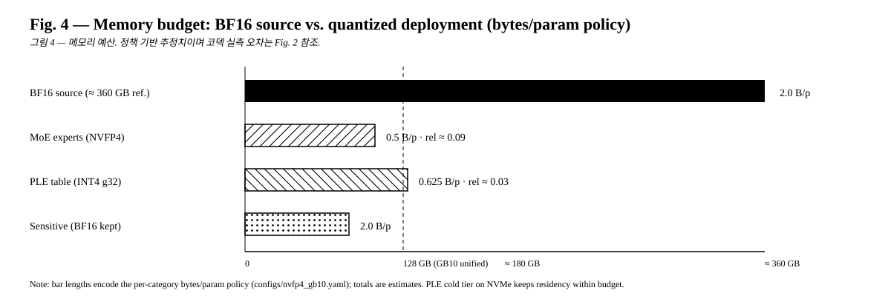

# 논문용 그림 (인쇄용 흑백본)

> 컬러 포트폴리오 그림(`docs/images/*.svg`)과 별개로, 논문·보고서에 바로 쓰는 보수적 흑백본입니다.
> 흰 배경·검정 선·해칭 패턴만 사용해 흑백 인쇄에서도 구분됩니다. 모든 수치는 `docs/evidence/` 실측값입니다.

## Figure 1 — 전체 구성



**Figure 1.** System overview of single-node GB10 quantization and serving.
(A) BF16 source (~360 GB). (B) Shard-streaming converter: MoE→NVFP4, PLE→INT4, sensitive layers kept in BF16.
(C) GB10 runtime: resident weights served by vLLM/SGLang (TP=1), PLE rows served from NVMe with an LRU cache.

**그림 1.** GB10 단일머신 양자화·서빙 전체 구성. (A) 원본, (B) 스트리밍 변환, (C) 상주+NVMe 하이브리드 서빙.

## Figure 2 — 용량–왜곡



**Figure 2.** Rate–distortion of seven PLE codec candidates (synthetic 512×160).
The adopted codec (■, affine_uint4_g32, 0.625 B/param, rel_l2 0.0302) dominates symmetric INT4 at comparable cost.
Method: `.venv/bin/python -m quantization.ple_codecs`. Source: `docs/evidence/ple_codecs_selftest.txt`.

**그림 2.** PLE 코덱 7종의 용량–왜곡 비교. 채택안(■)은 동급 용량의 대칭 INT4보다 오차가 작다.

## Figure 3 — 파이프라인과 검증 게이트



**Figure 3.** Deployment pipeline with verification gates G1–G4.
Each gate states its criterion and reproduction command; all numeric gates were measured on a GB10 machine (2026-10-13).

**그림 3.** 검증 게이트 포함 파이프라인. 각 게이트의 통과 기준과 재현 명령을 명시했다.

## Figure 4 — 메모리 예산



**Figure 4.** Memory budget under the bytes/param policy (`configs/nvfp4_gb10.yaml`).
Bars encode policy, not full-model measurement; codec errors are reported in Fig. 2.
The dashed line marks the 128 GB unified-memory budget; the NVMe PLE tier keeps residency within it.

**그림 4.** 메모리 예산. 막대 길이는 정책(추정)이며, 코덱 오차는 그림 2 참조. 점선은 128GB 경계.

## 인용 방법

```bibtex
@misc{ksi2026qwen38gb10,
  title  = {Qwen3.8-Flash-Next-GB10-NVFP4: single-node GB10 quantization and serving},
  author = {{KSI Corporation}},
  year   = {2026},
  note   = {\url{https://github.com/khakisketch/Qwen3.8-Flash-Next-GB10-NVFP4}}
}
```
